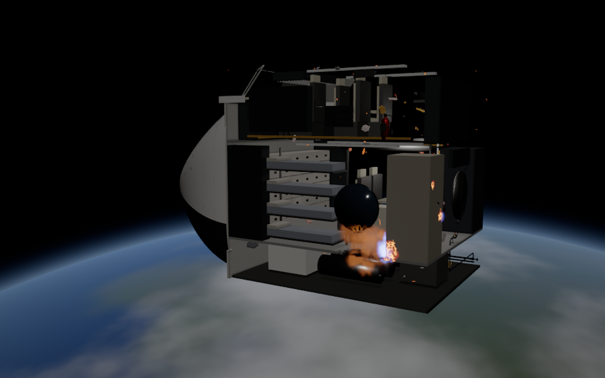
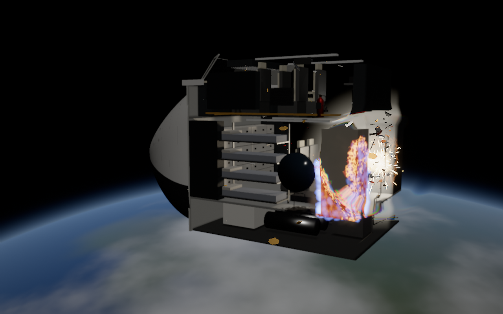
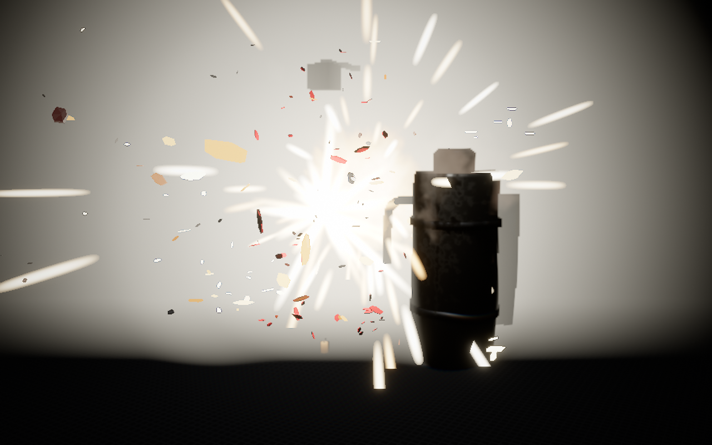

kara am van ankara van# Mikrogravite Alev Laboratuvarı

Tarayıcıda çalışan gerçek zamanlı 3B yanma simülatörü. Mum, gaz jeti, yakıt damlası ve katı levha alevlerini Dünya, Ay, Mars ve uzay istasyonu (mikro-g) koşullarında karşılaştırmanızı sağlar. Akış, kimya ve ışınım tamamen GPU'da (WebGL2) çözülür; alev, gerçek fiziksel büyüklüklerden (sıcaklık, kurum, CH* ışıması) hacimsel ışın yürütmeyle çizilir.

NASA Space Apps 2026 projesi olarak başlayan kaynak kodun yeniden düzenlenmiş, hataları giderilmiş ve yeni arayüzlü sürümüdür.

## Çalıştırma

**Windows'ta en kolay yol:** `baslat.bat` dosyasına çift tıklayın. Node.js yoksa winget ile kurar, paketleri yükler ve uygulamayı tarayıcıda açar. Menüden tek dosyalık (internetsiz çalışan) sürümü de derleyebilirsiniz.

Node.js 20 veya üstü gerekir.

```bash
npm install
npm run dev          # http://127.0.0.1:47321
```

Diğer komutlar:

| Komut | Açıklama |
| --- | --- |
| `npm run build` | `dist/` klasörüne üretim derlemesi |
| `npm run preview` | Derlemeyi `http://127.0.0.1:47322` adresinde sunar |
| `npm run build:single` | Her şeyi tek bir `dist-single/index.html` dosyasına gömer (çevrimdışı paylaşım için) |

Tarayıcı gereksinimi: kayan noktalı render hedefleri olan WebGL2 (`EXT_color_buffer_float`). Güncel Chrome, Edge, Firefox ve Safari 17+ çalışır. Tümleşik GPU'larda uygulama görüntü çözünürlüğünü kendiliğinden düşürür; yine de yavaşsa **Çözücü › Izgara çözünürlüğü** değerini azaltın.

## Neler var

**Fizik çözücü**
- Düşük Mach sayılı, değişken yoğunluklu tepkimeli akış. Skalerler korunan değişkenlerle (ρ, ρT, ρY) MacCormack yöntemiyle taşınır; ısı ve tür difüzyonu akı biçiminde, alt adımlı ve korunumludur; basınç kırmızı-siyah SOR ile çözülür.
- Katı yüzeylerde hayalet hücreler, sabit kütle akılı nozul girişi ve akış yönüne duyarlı açık sınırlar: yakıt ve enerji bütçesi kapanır.
- Westbrook–Dryer tek adımlı kinetik, kurum oluşumu ve oksidasyonu, optik ince ışınım, düşük sıcaklık "soğuk alev" kimyası.
- Mum fitili buhar kaynağı, d²-yasasıyla küçülen damla, piroliz cephesi ilerleyen katı levha.
- Katı levha, Saffire deneylerinde yakılan SIBAL kumaşının ölçülmüş özelliklerini kullanır: %75 pamuk, %25 cam elyaf, 18,2 mg/cm² (Saffire ve BASS eş-akış verileri: Olson vd., Combustion and Flame, 2023). Yüzeyden üflenen piroliz gazının ısı akısını azaltması film kuramıyla hesaba katılır. Tutuşturucu, deneydeki gibi ön kenar boyunca gerilmiş bir sıcak teldir ve 5 s açık kalır. 0 g ve 20 cm/s akışta alev tel kapandıktan sonra kendi başına yaklaşık 2 mm/s hızla yayılır (Saffire I ölçümü: 1,8 mm/s).
- **Konum** düğmeleri bir atmosferi bütün olarak kurar: Dünya deniz seviyesi, ISS kabini, sakin uzay, Ay habitatı, Mars habitatı ve Mars yüzeyi. **Oksitleyici** yalnız oksijen kesrini ve seyreltici gazı değiştirir (hava, zengin hava, saf O₂, CO₂, He, Ar, Mars gazı).
- Soğuk alev kimyası açıkken grafik **Alev** serisinde sıcak ve soğuk ısı salınımını ayrı eksenlerde birlikte çizer.
- Çizim 60 Hz ile sınırlıdır. Görüntü durgunken (duraklatılmış, kamera sabit) GPU boşta bekler. Bütçe, ekran aralığına değil karenin çizim süresine bakar; çizim 12 ms'yi aşarsa yalnız görüntü çözünürlüğü ve ışın adımı azalır. Fizik çözücüsü GPU hızından bağımsızdır: yavaş bir makinede simülasyon yavaşlar ama sonuç değişmez.
- **Söndür** (S) alevin üzerine hızlı bir inert gaz jeti yollar, kıvılcımı ve yakıt beslemesini keser. Bir tıklama yaklaşık 1 s benzetim süresi sürer; basılı tutmak jeti açık bırakır.
- **CO₂ tüpü** (T) alevi oksijenden kopararak boğar: alevin ve kaynağın çevresi inert gaz bulutuyla dolar, O₂ kesri düşer; yakıt beslemesi sürerken alev oksijensizlikten söner. Bir tıklama ~2 s boşaltır.
- **Alan boyutu** araç çubuğunda X · Y · Z (cm) kutularıyla değiştirilir; ölçüler kutunun kenar ortalarında yazar. Alev tavana ulaşırsa kutunun üst yüzü turuncu yanar ve uyarı çıkar.
- **Rüzgâr** hızı ve yönü (Ortam bölümü) yatay hava akımı kurar; alanın tabanında mavi bir okla gösterilir.
- Grafikte ve ölçüm şeridinde alevin görünür **ışık şiddeti** (kandela) izlenir; CSV dışa aktarımında da yer alır.
- Hücre türleri tek bir 8 bit dokuda tutulur; istatistikler GPU'yu bekletmeyen PBO okumalarıyla alınır.

**Görüntü**
- Fiziksel ışınım aktarımı: kurumun spektral kara cisim ışıması (Planck × CIE 1931, κ_λ = 4,9 f_v/λ) ve öz soğurması, ısı salınımıyla orantılı CH*/C₂* kemilüminesansı. Sahne ışığı alevin ışık şiddetinden (cd) hesaplanır. Ayrıca termal kamera, sıcaklık, ısı salınımı, kurum, hız, tür ve Schlieren görünümleri.
- Zamansal örnek biriktirme (TAA), enerji korunumlu bloom, AgX / ACES / Khronos Neutral ton eşleme, otomatik pozlama.
- Mum gövdesi, fitil, nozul, damla ve levha işaretli uzaklık alanlarıyla modellenir; alevin kendi ışığıyla yumuşak gölge ve ortam örtmesi alır.

**Arayüz**
- Solda temel denetimler paneli: Ateşle, Söndür, CO₂, kaynak, konum, 0 g ↔ 1 g ve görünüm modu tek tıkla seçilir.
- Ayrıntılı ayarlar (Deney, Görüntü, Analiz, Çözücü sekmeleri) sağdan kayan, genişliği ayarlanabilen bir çekmecededir ve kapalı açılır; mobilde alt sayfa.
- Açılış ekranı, gölgelendirici derleme ve ızgara kurulumu gibi gerçek başlatma adımlarını gösterir.
- **Analiz › Kaynaklar ve standartlar**: doğrulama ölçütleri (Saffire-I yayılma hızı, mikrogravitede mum, d²-yasası), ilgili uzay standartları (NASA-STD-7009A, NASA-STD-6001B, ECSS-Q-ST-70-21C, ISO 14624-1) ve kaynakça.
- Değerler doğrudan yazılarak düzenlenebilir (ok tuşları ile ince ayar, Shift ile ×10). Etikete çift tıklamak senaryo varsayılanına döndürür; değiştirilmiş değerler mavi noktayla işaretlenir.
- Ayarı değiştirince neyin olacağı simgeyle gösterilir: anında, alan sıfırlanır veya ızgara yeniden kurulur.
- Aranabilir senaryo tarayıcısı, zaman serisi grafiği (d² eğiminden K ölçümü dahil), ölçüm şeridi, renk ölçeği.
- Ekran görüntüsü (ölçüm künyesiyle PNG), CSV dışa aktarma, deney ayarlarını içeren paylaşım bağlantısı.

## Klavye kısayolları

| Tuş | İşlev |
| --- | --- |
| `I` | Ateşle |
| `S` (basılı) | Söndürücü |
| `T` (basılı) | CO₂ tüpü (oksijeni keserek boğ) |
| `Boşluk` | Duraklat / sürdür |
| `.` | Duraklatılmışken tek kare ilerlet |
| `R` | Alanı sıfırla |
| `G` | 0 g ↔ 1 g |
| `O` | Senaryolar |
| `V`, `1`–`9` | Görünüm kipini değiştir (onuncu görünüm, yapay zekâ: `A`) |
| `0` | Kameradan bak ↔ editör görünümü (fiziksel kamera) |
| `W` / `E` / `Q` | Kamera aracı: taşı / döndür / ölçekle (görüş açısı) |
| `F` | Kamerayı sığdır |
| `C` | Grafiği aç / kapat |
| `H` | Ayrıntılı ayarları aç / kapat |
| `M` | Sahne nesneleri (her biri ayrı eklenir / çıkarılır) |
| `N` | Yangın ve patlama: araçlar ve senaryolar |
| `X` | Patlama (seçili enerjide) |
| `B` | Arka plan: deney odası ↔ yörünge (Dünya ve yıldızlar) |
| `Y` | Yanıcılık modülü |
| `A` | Yapay zekâ tahmini (görünüm + panel) |
| `P` | Ekran görüntüsü |
| `?` | Kısayol listesi |

Fare: sürükle döndür, `Shift` + sürükle veya sağ tuş kaydır, tekerlek yakınlaştır, çift tık sığdır. Dokunmatik ekranda iki parmakla yakınlaştırıp kaydırabilirsiniz.

## Paylaşım bağlantısı

Adres çubuğundaki karma (`#p=iss-candle&o2=18&view=temp`) yalnızca senaryo varsayılanından farklı ayarları tutar. Bağlantıyı açan kişi aynı deneyi aynı görünümle görür. Grafik bağlamı kaybolursa ayarlar bu bağlantıda saklanır.

## Proje yapısı

```
src/
  core/       FL ad alanı ve modül yükleme sırası
  physics/    termodinamik, yakıt verisi, boyutsuz sayılar
  gl/         WebGL2 yardımcıları (doku, MRT, PBO okuma)
  shaders/    çözücü ve görüntü gölgelendiricileri (GLSL ES 3.0)
  sim/        zaman adımı, kaynak modelleri, istatistikler
  render/     kamera, ışın yürütme, TAA, bloom, ton eşleme
  data/       varsayılanlar ve senaryolar
  ui/         simgeler, denetim şeması, denetçi, HUD, uygulama döngüsü
  styles/     yazı tipleri ve arayüz stilleri
```

## Işınım, kamera ve yapay zekâ veri kümesi

- **Işınımla ısı transferi:** alevin her hacim öğesinin yaydığı ışınım 1/(4πr²) ile seyrelerek toplanır (optik ince ortamda ışınım aktarım denkleminin tam çözümü). Gaz bunun bir kısmını yeniden soğurur; duvarlara, tavana ve masaya gelen ışınım ısı akısı hesaplanır. **Işınım akısı** görünümünde (9) alanın duvarları ve masa ışınım akısı ölçen paneller gibi renklenir; ölçüm şeridinde **Duvar ışınım akısı** (kW/m²). Sınırlara ulaşan toplam güç, gazın net ışınım kaybına eşittir (enerji denetimi, mum alevinde %97).
- **Soğuk alev tayfı:** uyarılmış formaldehitin (CH₂O*) Emeléus bantları; mor ve mavi bantlar baskın. **Ozon katkısı** (O₃) soğuk alev kimyasını hızlandırır.
- **Fiziksel kamera** (Görüntü › Fiziksel kamera): Blender kamerası gibi sensör, odak uzaklığı, diyafram (alan derinliği), obtüratör (hareket bulanıklığı), ISO (gürültü), beyaz dengesi, doğal vinyet; pozlama ISO 12232 doyma tabanlı hızla fiziksel birimlerden hesaplanır. Kamera yalnız gerçek bir kameranın göreceğini gösterir.
- **Sahne kamerası nesnesi** (Blender / Roblox Studio gibi): `0` ile editör görünümüne geçince kamera sahnede görüş piramidiyle görünür. `W` taşı (renkli oklar eksen boyunca, beyaz merkez noktası serbest), `E` döndür (yeşil sapma, kırmızı yunuslama, mavi yuvarlanma halkası), `Q` ölçekle (köşe küpleri görüş açısını/odak uzaklığını büyütür-küçültür, sarı ok kamerayı ileri-geri götürür). Kameradan bakarken sürükle = kamerayı çevir, ⇧/sağ tuş = kaydır, tekerlek = ileri/geri, Ctrl + tekerlek = odak uzaklığı, çift tık = aleve çevir.
- **Yapay zekâ veri kümesi** (Analiz › Yapay zekâ veri kümesi): istenen sayıda kare için kamera görüntüsü, tepkime bölgesi maskesi ve yer gerçeği etiketleri (`labels.jsonl`: HRR, sıcaklık, alev boyu, ışık şiddeti, ışınım akısı, senaryo, kamera iç/dış parametreleri) tek bir .zip dosyasında. Alanlar `meta.json` içinde açıklanır.

## Sahne modelleri ve yanıcılık modülü

- **Model** (sol panel, `M`): CO₂ söndürücü, oksijen üreteci (SFOG), O₂ hattı ve vana, kabin paneli ve kablo demeti, mekik mürettebat kabini. GLB modelleri gerçek ölçekte yerleşir: küçükler masaya, deney kutusunun arkasına; kabinde deney orta güverte döşemesinde durur. Kabinin dışından bakarken kameraya bakan kabuk panelleri gizlenir.
- Model yüzeyleri ışın yürütücüyle aynı ışık modeliyle çizilir: alevin ışığı (sonlu kaynak, yumuşak gölge), **tavan lambası** (Görüntü › Sahne, lx), ortam ışığı ve model uzayındaki uzaklık alanından ortam kapatma. Model sahnedeyken otomatik pozlama sahneyi de ölçer.
- Model hesaplama alanına girerse içine düşen hücreler çözücüde eylemsiz katı olur (Deney › Sahne modeli › *Alana giren parçalar katı engel*).
- **Yanıcılık** (`Y`): parçaları modelin kendi sınıfına (0 Yanmaz … 3 Yüksek) ya da *bu atmosferde* durumuna göre renklendirir. İkinci kip ortamın O₂ yüzdesini malzemenin yaklaşık sınırlayıcı oksijen indisi (LOI) aralığıyla karşılaştırır: Söner / Sınırda / Yanar; O₂ taşıyan ve üreten parçalar "Oksitleyici" olarak ayrılır. Parçaya tıklamak ayrıntıyı (malzeme, LOI, not) gösterir. Değerler eğitim amaçlıdır, NASA-STD-6001B testlerinin yerine geçmez.
- Kabin modelinde boşta kalan O₂ uçları (ana hat, vana girişi/çıkışı, SFOG çıkışı, ön yükseltici) `tools/o2-baglanti.mjs` ile bağlanmıştır: `node tools/o2-baglanti.mjs` kaynak modeli (`tools/models-src/`) okur, çakışma denetimiyle dirsekli borular, rakorlar, PTFE contalar, döşeme/perde geçişleri, kelepçeler ve SFOG çek valfini ekleyip `src/assets/models/mekik_kabini.glb` dosyasını yazar.

- **Burun ve camlar:** kabinin önüne Orbiter biçimli bir burun gövdesi (RCC başlık, siyah karo karın, beyaz üst, derzler, ön iniş takımı kapısı çizgisi, 14 RCS portu) ve eğimli, altı camlı kokpit çatısı (ortada iki ön cam, iki ön-yan, iki yan) eklenmiştir: yaklaşık 6,8 bin üçgen. Burun uzaklık alanına girmez (kabin içi gölge çözünürlüğü değişmez); çatı, kamera kabinin üstüne çıkınca gizlenir. Üretim sırası: `node tools/o2-baglanti.mjs && node tools/burun-detay.mjs`.

## Yangın, patlama ve sahne nesneleri

Akış çözücüsündeki alevin (mum, jet, damla, levha) yanına ikinci bir yanma modeli eklendi: sahne nesnelerinin yüzeyi **yangın hücrelerine** bölünür ve bir hücre ancak yakıt + ısı + oksitleyici bir aradayken yanar (yangın üçgeni). Alev, duman, kıvılcım, enkaz ve şok dalgası "canlandırma" değildir; yalnız bu modelin durumunu çizer. Yanma çekirdeği [ignition-fx](../ignition-fx) projesinden alınmış, three.js yerine uygulamanın kendi WebGL2 katmanına taşınmıştır (`src/fx/`).

**İki çözücü birbirine bağlıdır**
- Akış çözücüsündeki alev çevresindeki yüzeyleri ısıtır: ışınım `q″ = χ·Q̇/(4πr²)` (χ ≈ 0,3) ve alev teması / 1 g'de tüy (~60 kW/m²). Mumun yanındaki hortum, kablo ya da kumaş ondan tutuşur; bir mumun birkaç santimetre ötesindeki ışınımı ise tutuşturmaya yetmez.
- Nesne yangını kabin oksijenini tüketir ve **Ortam › Oksijen** değerine geri yazar: kabin havası fakirleştikçe mum da zayıflar; yangın yakıt bitmeden sönebilir. O₂ hattı ya da oksijen üreteci yarılırsa yüzde yükselir ve daha çok malzeme yanıcı hale gelir.
- Patlamanın basınç dalgası akış çözücüsündeki alevi üfler; söndürücü bulutu onu da boğar. Gövde delinince kabin basıncı düşer ve iki model de oksitleyicisiz kalır.
- Yanıcılık modülü (`Y`) ile aynı veriyi kullanır: bir parçanın yanıp yanmayacağına malzemesinin LOI aralığı ve modelin kendi sınıfı karar verir. *Bu atmosferde* "Söner" görünen parça tutuşmaz; O₂ yükseltilince tutuşur (ör. Nomex %30 O₂'de).

**Uygulanan ilkeler**

| İlke | Modeldeki karşılığı |
| --- | --- |
| Yangın üçgeni | Yakıt, ısı (tutuşma sıcaklığı) ve oksitleyici (etkin O₂ ≥ LOI) birlikte gerekir; biri kalkınca hücre söner. |
| Pilotlu / kendiliğinden tutuşma | Kıvılcım ya da alev varken tutuşma sıcaklığı, yokken daha yüksek kendiliğinden tutuşma sıcaklığı. |
| Oksijen taşınımı | 1 g'de yüzdürme alevi besler. Durgun mikrogravitede yalnız difüzyon kalır, alev kendi ürünlerinde boğulur; ~0,15 m/s havalandırma en iyi beslemeyi verir; çok hızlı akış üfleyip söndürür. |
| Yayılma yönü | 1 g'de yukarı hızlı; mikrogravitede akışa karşı (taze oksijene doğru). |
| Kapalı hacim | Yangın oksijeni tüketir, gazı ısıtır, basıncı yükseltir. |
| Basınç ve vakum | Etkin oksijen kısmi basınca bağlıdır. Vakumda şok dalgası, asılı duman ve taşınımla soğuma yoktur; parçalar düz çizgide uçar. |
| Basınçlı kap | Cidarının bir bölümü yeterince uzun kızgın kalan kap yarılır. **CO₂ tüpü** inert gazdır: ateş topu yok, boşalan gaz çevredeki alevi boğar. **Oksijen üreteci** (Mir, 1997) ve **O₂ hattı** kabini zenginleştirir. **Li-iyon pil** kendi oksitleyicisini taşır. |
| Kızgın parçalar | Patlamadan saçılan enkaz düştüğü yerde pilot kaynaktır. |

**Kullanım**
- **Nesneler** (sol panel, `M`): her model ayrı bir sahne nesnesidir; liste açık kalır, istediğiniz kadarını birlikte ekleyip çıkarabilirsiniz (yan yana dizilirler). Mekik kabini diğer dördünü içinde taşıdığı için tek başınadır: kabin seçiliyken öteki nesneler kilitlidir. Sahnede herhangi bir nesne varken deney düzeneği (mum, jet, damla, levha) olmaz: nesne eklenince düzenek, boş deney kutusu ve ölçüleri kaldırılır; **Kaynak** listesi nesneler kaldırılana kadar kilitlidir. Bir senaryo yüklemek nesneleri kaldırıp düzeneği geri getirir.
- **Yangın** (sol panel, `N`): tıklama aracı seçin (*Kıvılcım*, *Patlayıcı*, *Söndürücü*) ve sahnede bir noktaya tıklayın; sürükleme görünümü döndürmeye devam eder, `Esc` aracı kapatır. Hazır senaryolar: *kısa devre*, *tüp yanında yangın*, *patlama* (`X`), *gövde delinmesi* (kabin). Neyin neden tutuştuğu ya da tutuşmadığı sol alttaki günlükte yazar; üstteki çip yangın gücünü, yanan alanı ve kabin atmosferini gösterir. `R` her şeyi (parçalar, kabin havası) geri getirir.
- Patlayıcı enerjisi ve O₂ bağlantısı: **Deney › Yangın ve patlama**.
- **Uzaydan Dünya'ya bakış** (`B`, **Görüntü › Sahne › Arka plan**): kıtalar, bulutlar, gündüz/gece sınırı, atmosfer halesi ve yıldızlar; kabin camlarından da görünür. *Otomatik* kipte kabin modelinde ve mikrogravitede açılır.

**Kamera ve veri kümesi**
Efektler ışın yürütücüyle aynı kareye, fiziksel birimlerle (cd/m² × pozlama) eklenir; fiziksel kamera (ISO, obtüratör, diyafram, alan derinliği, hareket bulanıklığı) onları sahnenin parçası olarak görür. Veri kümesi dışa aktarımı her kare için şunları da yazar:
- `truth.flame_present`, `truth.flame_kinds` (`candle_diffusion`, `solid_sheet_spread`, `surface_fire`, `explosion`…): alev var mı, ne tür.
- `truth.fire`: yangın gücü [kW], yanan alan, kızışan (henüz alev almamış, piroliz dumanı veren) hücre sayısı, kabin O₂ / basınç / gaz sıcaklığı, gövde deliği, son patlama (enerji, ateş topu, şok dalgası, merkez).
- `truth.fire.regions[]`: yanan her parça için nesne, malzeme, alev rengi (mavi: yüzdürmesiz, sarı: kurumlu), merkez (m ve piksel) ve görüntüdeki sınır kutusu: **nerede, nasıl alev**.
- `projected_px.flame_bbox`: akış çözücüsündeki alevin sınır kutusu. `masks/`: akış çözücüsünün tepkime bölgesi ile nesne yangınının alev gövdesi birlikte (duman, kıvılcım, enkaz hariç).

**Kare hızı**
- Çizim ekranın tazeleme hızında yapılır (60 Hz tavanı kaldırıldı). Akış çözücüsü ondan bağımsız bir **alt adım bütçesiyle** ilerler (saniyede 60 × *En çok alt adım*): 60 Hz ekranda kare başına 6 alt adım, 165 Hz ekranda aynı iş karelere yayılarak kare başına ~2. Her kare kısa kalır, benzetim hızı değişmez.
- WebGL durum ve uniform önbelleği: çözücü kare başına ~340 tam ekran geçişi çalıştırır ve her geçişte aynı ~30 uniform'u yeniden gönderiyordu. Değişmeyen değer ve zaten bağlı olan doku / hedef için çağrı yapılmaz.
- **Kare hızı yöneticisi** (ignition-fx'ten uyarlandı): kare hızı hedefin altına inerse önce kare başına alt adım sayısını (benzetim ağır çekime geçer, sonuç değişmez), sonra görüntü çözünürlüğünü, ışın adımını ve parçacık yoğunluğunu kısar; toparlanınca yavaşça geri açar.
- Efektler: durumsuz parçacıklar (hareket köşe gölgelendiricisinde kapalı biçimde), bütün alev/duman/kıvılcım 3 çizim çağrısı, alev ve duman yarım çözünürlüklü tamponda, enkaz tek örneklenmiş çizim, bütçeli doğum.
- Dünya arka planı ve yanık izi ışın yürütücünün dışında (ayrı geçiş, model G-tamponu) hesaplanır: ana gölgelendiricinin derleme süresi uzamaz.

Ölçüm (RTX 5070 Laptop, başsız Edge, D3D11, 1280×800, *Dünya · Mum alevi* + üç nesne; `tools/cdp.mjs`):

| | Önce | Sonra |
| --- | --- | --- |
| Kare hızı (canlı döngü, tam kalite) | 60 fps (tavan) | 126–157 fps |
| Benzetim hızı (gerçek zamana oran) | ×0,28 | ×0,29 |
| Çözücü adımı (6 alt adım, GPU dahil) | 10,5 ms | 9,4 ms |
| Kare süresi: yangın yok / nesne yangını / patlama | — | 16,7 / 15,1 / 13,6 ms (kare başına 6 alt adımla; efektlerin ölçülebilir maliyeti yok) |

Başsız tarayıcıda dikey eşleme yoktur; gerçek ekranda kare hızı tazeleme hızıyla sınırlıdır. Mikrogravite mum senaryosunda eski ve yeni kod aynı sonucu verir (t = 6,08 s: HRR 131 → 139 W, T_maks 1610 → 1600 K; fark alevin kaotik salınımı mertebesinde).

**Benzetim hızı**
Varsayılanlar benzetim gerçek hıza yakın aksın diye ayarlıdır: ızgara 32 hücre, CFL 3, kare başına en çok 12 alt adım ve **Görüntü › Kalite › Gerçek zaman öncelikli** açık (yük artınca kare hızı düşer, alev ağır çekime geçmez). Ölçüm (aynı makine, canlı döngü): 1 g mum ×0,29 → ×0,76–0,89 (33–44 fps); mikrogravite mum, levha ve damla ≈ ×0,9–1,0 (ızgara 40 ile ölçüldü); gaz jeti ×0,39 (jet büyük zaman adımında söndüğü için CFL 1,6 ile yürür). Daha yüksek kare hızı için *Gerçek zaman öncelikli*yi kapatın; daha keskin alev için **Çözücü › Izgara**'yı 40–48 yapın (yavaşlar).

**Sınırlar**
- Yüzey yangını bir efekt modelidir, CFD değildir: kabin tek bir karışmış hacimdir, havalandırma düzgün bir akış alanıdır. Yayılma ve ısınma izlenebilir olsun diye hızlandırılmıştır (akış çözücüsündeki alevden ısınma ×4, kabinde ışınımla ısınma ×6; oksijen tükenmesi ayarlanabilir, varsayılan ×0,3).
- Parçalanan parça kaybolur ve enkaza dönüşür; kırılma geometrisi hesaplanmaz. Enkaz kabin kutusuyla çarpışır, nesnelerle çarpışmaz.
- Değerler eğitim ve tehlike farkındalığı içindir; NASA-STD-6001B testlerinin ve uçuş güvenliği analizinin yerine geçmez.

Duman testi: `node tools/cdp.mjs --gpu=high --expr-file=tools/fx-test.js --out=docs/fx --timeout=500` (geliştirme sunucusu açıkken; başsız Edge). Örnek kareler `docs/fx/` altındadır:

| Kabin, yörünge, kısa devre | Kabinde patlama ve gövde tahliyesi | Masa üstü: tüplerin yarılması |
| --- | --- | --- |
|  |  |  |

## Yapay zekâ: kokpit yangın modeli

`cockpit_fire_model.joblib` (LightGBM; 2 sınıflandırıcı + 5 regresör, her biri 400 ağaç) uygulamaya gömülüdür ve tarayıcıda çalışır; sunucu gerekmez.

| Girdi (10) | Çıktı |
| --- | --- |
| yanıcılık sınıfı (0–3), O₂ %, basınç, hava akışı, yerçekimi, kalınlık, alan, sıcaklık, tutuşturucu gücü ve süresi | tutuşma olasılığı, alevin sürme olasılığı, tutuşma süresi, yayılma hızı (mm/s), tepe ısı salınımı (W), yanma süresi, yanan kesir |

- **Aktarım:** `node tools/ai-export.mjs` joblib dosyasındaki LightGBM metin modellerini ayrıştırır (turşu çözülmez) ve `src/assets/ai/cockpit_fire_model.bin` dosyasını yazar (1,4 MB). Çıkarım `src/ai/forest.js` içinde düz ağaç gezintisidir; LightGBM'in kendi çıktısıyla 400 rastgele girdide ham skor farkı < 3·10⁻⁷ (`tools/ai-verify.mjs`).
- **Yapay zekâ görünümü** (`A`, sol panelde **Yapay zekâ**, ya da Görünüm listesi): parçalar modelin öngördüğü riske göre boyanır (yeşil → kırmızı; yanmaz parçalar gri). Girdiler sahneden gelir: parçanın yanıcılık sınıfı, yüzey alanı ve kalınlığı; ortamın O₂'si, basıncı, havalandırması, yerçekimi ve sıcaklığı. Ortam değişince (ör. O₂ %30) harita anında yenilenir.
- **Öngörü ↔ benzetim:** bir parça tutuşunca tutuşma noktası işaretlenir; modelin öngördüğü alev cephesi ve yanmış bölge macenta, öngörülen son yayılma sınırı beyaz kesikli çizilir. Benzetimde gerçekleşen alev aynı karede camgöbeğidir. **Öngörüyü ileri sar** kaydırıcısı cepheyi 15 dakikaya kadar ileri gösterir.
- **Sırada:** yanan parçaların hemen yanında duran ve modelin bu atmosferde "yanar ve yayılır" dediği parçalar macenta yanıp söner ve panelde listelenir.
- **Panel:** seçili parça (tıklayın) için karar, olasılıklar ve beş regresyon çıktısı; tutuşturucu gücü / süresi kaydırıcıları; modelin gördüğü on girdi (eğitim aralığının dışına çıkanlar kırpılır ve işaretlenir); en riskli parçalar listesi ve **Tutuştur** düğmesi. Sahnede nesne yokken tahmin deney düzeneği (mum, levha…) için yapılır.
- Model fiziksel hızı (mm/s) öngörür; benzetimdeki yüzey yangını izlenebilsin diye hızlandırılmıştır. İkisi bu yüzden aynı saatle ilerlemez; karşılaştırma niteldir.

## Görünümler ve nesne yangını

Nesne yangını (alev, duman, kızgın yüzey) artık on görünümün hepsinde çizilir: **Termal kamera** ve **Sıcaklık** (alev ve yüzey sıcaklığı, inferno), **Isı salınımı** (tepkime kabuğu), **Kurum** (kurumlu alev gövdesi ve duman), **Hız** (yanan gazın hızı), **Türler** (çekirdekte yakıt, kabukta O₂ tükenmesi), **Schlieren** (sıcak gazın yoğunluk gradyanı), **Işınım akısı** (T⁴) ve **Yapay zekâ**. Bilimsel görünümlerde model, biçimi okunan nötr bir gölgelendirmeyle çizilir; termal kamerada ortam sıcaklığındaki nesneler de soluk biçimde seçilir.

## Kabinde yangının yayılması

- **Havalandırma:** mekik kabininde fanlar havayı dolaştırır (**Deney › Yangın ve patlama › Kabin havalandırması**, varsayılan 15 cm/s). Mikrogravitede alevi besleyen tek akış budur; 0 yapılırsa alev kendi ürünlerinde boğulur.
- **Işınımla sıçrama:** yanan hücreler kümelere toplanır ve çevredeki yüzeyleri q″ = χ·Q̇/(4πr²) ile ısıtır; alev dolaptan uyku tulumuna, kâğıda, kumaşa atlar. Sıcak gaz katmanı da henüz yanmayan yüzeyleri ısıtır.
- **Oksijen:** tükenme hızı ayarlanabilir (**O₂ tükenme hızı**, 1 = fiziksel, varsayılan 0,3; 0 = yaşam desteği karşılar). Yangın büyüdükçe O₂ düşer ve alev yakıt bitmeden söner.
- **Basınç tahliye vanası:** yangının ısıttığı gazın yavaş basınç artışı dışarı atılır; gövdeyi yalnız patlamanın ani aşırı basıncı yırtar.

## Modelin sınırları

Bu bir eğitim ve keşif aracıdır; ayrıntılı kimya yerine tek adımlı kinetik ve kalibre edilmiş bir verim katsayısı kullanır. Kaba ızgarada alev cephesi birkaç hücreye yayılır, bu yüzden mutlak alev boyu ve sönme sınırları deneysel değerlerden sapabilir. Eğilimler (yerçekimi, oksijen, basınç ve seyreltici etkisi) güvenilirdir. Ayrıntılar uygulamada **Analiz › Model ve varsayımlar** bölümündedir.

am kara am
